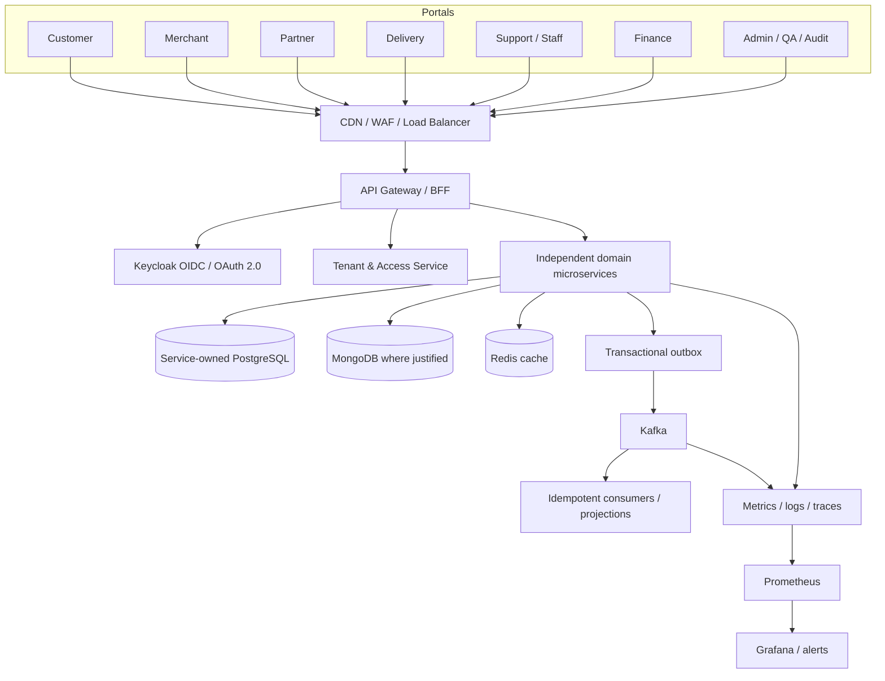

# Kart-Me Architecture — P00 Proposal

**Status:** Proposed; requires owner review.

## 1. Architecture style

Independent domain microservices, deployed and scaled independently, with explicit API/event contracts and data ownership. This is a deliberate product decision and carries meaningful operational cost: service count must be matched by CI/CD maturity, observability, platform engineering, on-call readiness, and contract testing.

## 2. Logical architecture

## 3. Proposed service catalog

The service list is a candidate decomposition, not authorization to create code. During P00, confirm service boundaries and ownership before P01.

1. **API Gateway/BFF** — routing, request limits, correlation, API composition; not the sole authorization layer.
2. **Tenant & Organization** — tenant lifecycle, memberships, plans/quotas, organization/store ownership.
3. **Identity Integration / Authorization Policy** — Keycloak integration, role/permission mapping and service-side policy enforcement. Keycloak remains identity provider; do not duplicate passwords or identity stores.
4. **Merchant & Partner** — merchant onboarding, partner records, verification workflows and store ownership.
5. **Catalog** — products, variants, categories, product lifecycle and media metadata.
6. **Search** — search queries and derived index projections; index is rebuildable, not source of truth.
7. **Pricing & Promotions** — price lists, coupons, discount eligibility, promotion rules.
8. **Inventory** — stock, locations, reservations, movements and reconciliation.
9. **Cart** — cart lifecycle and item selections.
10. **Checkout** — checkout quote, orchestration, validation, shipping/tax/pricing coordination.
11. **Order** — order aggregate, order-line snapshots, state transitions, cancellation policy.
12. **Payment** — provider adapters, payment attempts, signed webhooks, refunds and reconciliation.
13. **Fulfillment/Shipping** — shipments, packages, shipping rates and fulfillment status.
14. **Delivery** — agent onboarding/availability, assignments, delivery proof and exceptions.
15. **Returns & Refund Workflow** — return requests, eligibility, inspection, refund coordination; payment service owns provider refund execution.
16. **Support/Case Management** — cases, escalation, permitted context and action approvals.
17. **Finance/Settlement** — commissions, seller settlements, ledger/reconciliation reports and tax exports; define authoritative financial records before implementation.
18. **Notification** — email/SMS/push adapters, templates, delivery status and retry policy.
19. **Review & Reputation** — product/store reviews and moderation.
20. **Audit & Compliance** — immutable or tamper-evident audit event handling, retention and access review.
21. **Reporting/Analytics** — derived read models and reports, with PII minimization.
22. **Configuration/Feature Policy** — feature flags, tenant-level settings and controlled rollout.
23. **Operations/Incident** — operational queues and incident workflows; infrastructure dashboards may remain in platform tooling.
24. **Media/Asset** — upload policy, metadata, scanning and object storage integration.
25. **Tax/Compliance Rules** — tax rule configuration and calculation integration; clarify ownership versus pricing/checkout.
26. **Warehouse/Fulfillment Operations** — warehouse/location operations if not owned by fulfillment.
27. **QA/Test Operations** — test-run metadata and synthetic data orchestration; avoid a general-purpose production data access portal.

Avoid splitting services that have no independent ownership or scaling need. The final count is not a goal; clear boundaries and operability are.

## 4. Data technology rules

- PostgreSQL: authoritative relational/transactional state, with one owning service per database/schema boundary and no cross-service writes.
- MongoDB: only for document-shaped, evolving data with justified access patterns; no duplicate source of truth without reconciliation.
- Redis: cache/ephemeral state, bounded TTL/eviction, invalidation and cold-cache plan; not sole durable order/payment truth.
- Kafka: versioned event contracts, aggregate-key partitioning when order matters, bounded retry, DLQ, replay and consumer deduplication.
- Flyway: per-service migration ownership and immutable applied migrations; expand/migrate/contract for rolling deployments.
- Replicas are not backups; backup restore and point-in-time recovery must be tested.
- Sharding is postponed until measurements justify it and shard key/rebalancing/tenant skew are designed.

## 5. Communication policy

- REST/OpenAPI: default public/client-facing and standard synchronous APIs.
- Kafka: asynchronous domain events and decoupled projections/workflows.
- gRPC: only for internal calls where typed contracts/streaming/latency justify it.
- GraphQL: optional BFF aggregation only if it solves a defined client problem; query complexity and field-level authorization required.
- No synchronous call chain should be unbounded; set per-hop and overall deadlines.
- Avoid distributed transactions across services; use saga/process managers and compensating actions for multi-service workflows.

## 6. Resilience and consistency

- Timeouts, bounded exponential backoff with jitter, idempotency, circuit breakers, bulkheads, concurrency limits, backpressure and load shedding.
- Retry ownership is explicit; avoid retry amplification across layers.
- Outbox for database-to-Kafka publication; inbox/deduplication for consumers.
- Reconcile payment provider state, inventory drift, stuck orders and settlements.
- Strong local consistency for order/payment/inventory/financial invariants; eventual consistency for search, notification and analytics.
- CAP is operation-specific under partition; do not label the entire platform CP or AP.
- Quorum is not a substitute for business invariants or transactional boundaries.

## 7. Security and tenant isolation

- Keycloak OIDC/OAuth 2.0; validate JWT signature, issuer, audience, expiry, key rotation and required claims.
- Gateway authentication is not sufficient: each service authorizes the operation and resource.
- Tenant context comes from verified identity plus server-side membership.
- Explicit tenant scoping in queries, unique constraints and cache keys; include tenant context in events where appropriate.
- CORS allowlists are not authorization.
- Sensitive actions require least privilege, audit and step-up authentication/approval where appropriate.
- Do not put raw user IDs, order IDs, tokens, or unbounded tenant IDs in metric labels.
- Use TLS, secret management, image/dependency scanning, network policies, non-root containers and resource limits.

## 8. Platform and operations

- Java 21, Spring Boot version selected in P01 after compatibility review, Angular, Maven.
- Jenkins CI/CD; PMD, SonarQube, dependency and image scans; contract and integration tests.
- Docker images; OpenShift/Kubernetes for orchestration, health probes, autoscaling, disruption budgets and rollout control.
- Prometheus/Grafana, structured logs, OpenTelemetry traces, alert ownership and runbooks.
- Define RTO/RPO, recovery owner, backup retention, restore drills, failover authority, reconciliation and return-to-primary.
- No production deploys or autonomous agent actions without explicit approval.
